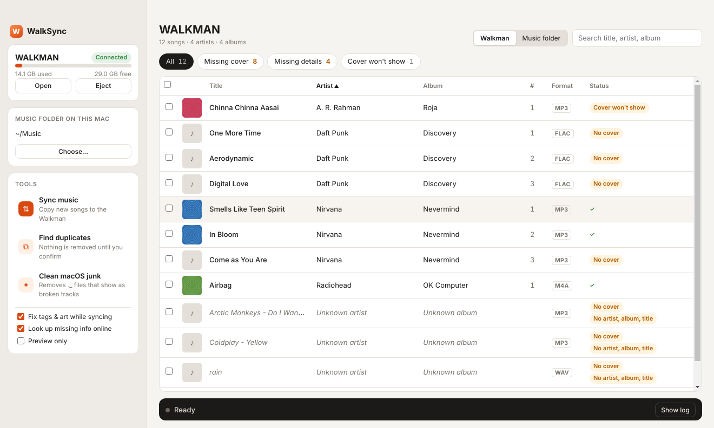
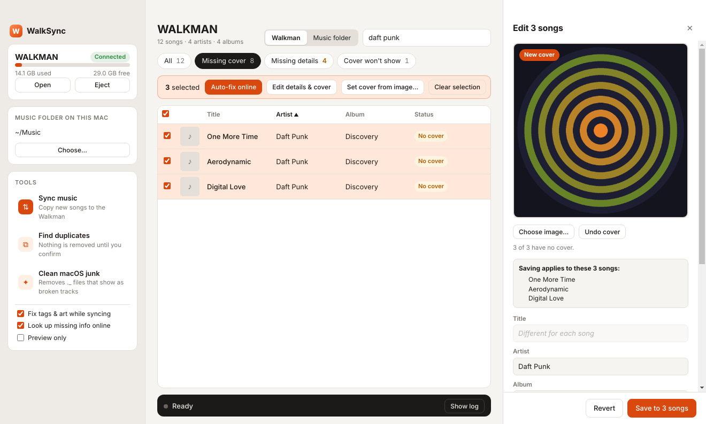

<p align="center"></p>

<h1 align="center">WalkSync</h1>

<p align="center">A Mac replacement for Sony Music Center, built for the <b>Walkman NW-A55</b>.<br>
Fix missing cover art and song details, sync music and remove duplicates.</p>

<p align="center"><a href="../../releases/latest"><b>⬇ Download the latest release</b></a></p>



It should also work with other NW-A and NW-ZX models that show up as a USB drive.

## Features

* **Library view.** Plug in the Walkman and every song appears with its cover. Filter to **Missing cover**, **Missing details** or **Cover won't show**, select songs (click, ⌘-click, ⇧-click, or the header checkbox), then:
  * **Auto-fix online** fills whatever is missing from MusicBrainz and iTunes and converts covers the player can't show.
  * **Edit details & cover** opens a panel where you edit tags and set a cover. Search online and click a result to take its cover and details, choose an image file, or drag one onto the cover. With several songs selected, album, artist, year, genre and cover apply to all of them.
* **Sync** copies new music from your Mac to the Walkman. Songs already on the player are skipped. When your library holds the same song twice, it copies only the best copy.
* **Fix while syncing.** Copies get missing artist, album, title and track numbers filled in, from the file name and folders first and then MusicBrainz and iTunes, and cover art embedded in a format the Walkman can display.
* **Find duplicates** finds the same song stored more than once and keeps the best copy (lossless over lossy, higher bitrate, has art, more tags). The extras are *moved* to `~/Music/Walkman Duplicates`, never deleted.
* **Clean macOS junk** removes the `._` files and `.DS_Store` that the Mac leaves behind and that show up as broken tracks on the player. It also stops Spotlight from indexing the Walkman.



## How it works (why no reverse engineering was needed)

Music Center doesn't talk to the NW-A55 over a private protocol. In USB "Data transfer" mode the player mounts as an ordinary drive. Music Center copies files into `MUSIC/`, and the Walkman rebuilds its own library database when you eject it. Everything the player displays comes from the files themselves:

| What you see on the Walkman | Where it comes from | What WalkSync does |
|---|---|---|
| Artist / Album / Title / Track # | Tags inside each file | Fills gaps from file names and folders, then MusicBrainz and iTunes |
| Cover art | Picture **embedded** in each file | Embeds it as a **baseline** JPEG at 600 px or less. The player can't show progressive JPEGs and chokes on huge art |
| Broken "tracks" | macOS `._` metadata files | Deletes them after every sync |

Tags are written as ID3v2.3 for MP3 (the version the Walkman reads most reliably), Vorbis comments for FLAC, and iTunes atoms for M4A/ALAC. Cover art can be embedded in MP3, FLAC and M4A.

## Install

1. Download `WalkSync-<version>-arm64.dmg` from [Releases](../../releases/latest).
2. Open it and drag **WalkSync** into **Applications**.
3. The app isn't signed with an Apple developer certificate, so the first time, **right-click WalkSync → Open → Open**. If macOS says the app is damaged, run this once in Terminal:
   ```bash
   xattr -cr /Applications/WalkSync.app
   ```
4. WalkSync needs Python 3.9+ (`brew install python`). On first launch, click **Install engine**. It creates a private Python environment with `mutagen` and `Pillow`, which takes about a minute.

Requires a Mac with Apple Silicon (M1 or later) and macOS 11 or later. Intel Macs aren't supported.

## Using it

1. On the Walkman, plug in USB and choose **Data transfer**. Your songs appear in the main window.
2. Click **Missing cover**, tick the header checkbox to select them all, and pick **Auto-fix online**. For anything it can't find, click the song and choose the right cover yourself.
3. To add music, **Choose…** your music folder in the sidebar and click **Sync music**.
4. **Eject**, unplug, and let the Walkman rebuild its library.

The **Walkman / Music folder** switch at the top shows your Mac library instead, so you can fix it once and every future sync is clean. **Preview only** in the sidebar applies to Sync and Clean.

Sync never modifies your library. Fixes during a sync apply to the copies on the Walkman.

## Command line

The engine works on its own without the app:

```bash
cd walksync/engine
pip3 install -r requirements.txt
python3 walksync.py status
python3 walksync.py sync ~/Music/MyMusic --fix --online
python3 walksync.py fix --online                 # on the Walkman
python3 walksync.py fix ~/Music/MyMusic --online # on your library
python3 walksync.py dedupe                       # report only
python3 walksync.py dedupe --apply               # move duplicates out
python3 walksync.py clean
python3 walksync.py lookup "Coldplay" "Yellow"   # test the online lookup
```

Every command that changes files accepts `--dry-run`. Use `--device /Volumes/NAME` if the player isn't detected automatically.

## Online lookups

* **MusicBrainz** (artist, album, year, track #) and the **Cover Art Archive** (artwork). These are free and need no key. WalkSync keeps to their limit of one request per second, so large libraries take a while on the first run.
* **iTunes Search API** is the fallback for album and artwork (600 × 600). It also needs no key.
* Results are cached in `~/.cache/walksync/lookups.json`, so re-runs are fast.
* Auto-fix only looks up songs that are missing something, and never overwrites tags that are already set. Only your own edits in the edit panel replace existing values.

## How duplicates are matched

Two files count as the same song if either of these holds:

* they are byte-identical copies, or
* they have the same artist and title (ignoring case, "feat.", "(Remastered)" and similar) and their lengths are within 3 seconds of each other.

Live and alternate versions with different lengths are kept.

## Limitations

* No playlist sync yet. `.m3u8` files in `MUSIC/` do work on the player if you make them yourself.
* No transcoding. The NW-A55 plays MP3, AAC/M4A, ALAC, FLAC, WAV, AIFF, APE, WMA and DSD natively.
* Cover art isn't embedded into WAV, AIFF, WMA or DSD files.

## Building from source

You need Node 20+ and Python 3.9+ (`brew install node python`).

```bash
cd app
npm install
npm start          # run the app in development
npm run dist       # build app/dist/WalkSync-<version>-arm64.dmg
```

The app's code is in `app/`: `main.js` is the Electron main process, and `renderer.js`, `index.html` and `styles.css` are the window. All file work is done by the Python engine in `engine/walksync.py`, which is bundled into the app.

## Releasing

Releases are built by GitHub Actions (`.github/workflows/release.yml`) on a macOS runner:

```bash
git tag v1.0.1
git push origin v1.0.1
```

The workflow sets the app version from the tag, builds the DMG and publishes it as a GitHub Release with generated release notes. To build without releasing, open **Actions → Build & Release → Run workflow** and download the DMG from the run.

## License

[MIT](LICENSE)
